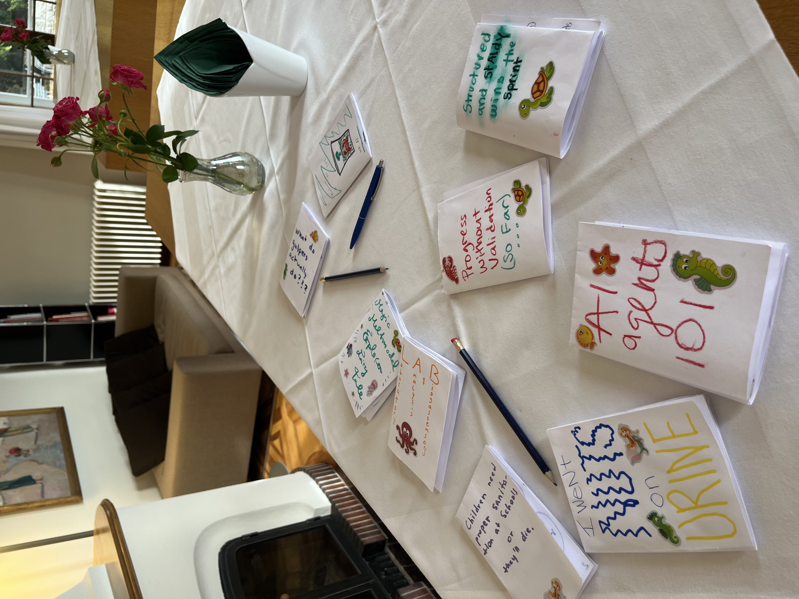

---
# "Ledger". Every number on a slide is read from window.TALK (../shared/data.js).
# Elements with data-v are filled from that file when the deck loads; the text typed
# in the slide is the same value and only a fallback. All figures are drawn in deck.js.
pagetitle: "Embedded data stewardship"
lang: en-GB
format:
  revealjs:
    theme: [default, deck.scss]
    width: 1600
    height: 900
    margin: 0
    controls: false
    progress: false
    slide-number: c/t
    menu: false
    overview: false
    html-math-method: plain
    hash: true
    transition: none
    embed-resources: true
    center: false
    include-in-header:
      - file: ../shared/font-face.html
      - text: |
          <script src="../shared/d3.v7.min.js"></script>
          <script src="../shared/data.js"></script>
    include-after-body:
      - text: |
          <script src="deck.js"></script>
---

## {#s-title .bare}

```{=html}
<div class="stage s-title">
  <div class="tt">Embedded data stewardship and research intelligence</div>
  <div class="ts">Five years of practice at a research group at ETH Zurich</div>
  <div class="ta">
    <div class="who" data-v="talk.authors" data-f="raw">Lars Schöbitz, Colin Walder, Adriana Clavijo Daza, Elizabeth Tilley</div>
    <div data-v="talk.affiliation" data-f="raw">Global Health Engineering, ETH Zurich</div>
    <div data-v="talk.event" data-f="raw">Research Data Conference 2026, Bern, 19 November 2026</div>
  </div>
</div>
```

::: notes
Thank you very much for the introduction. I am very happy to be here and to talk about something very dear to me, data stewardship, because that is what I am: an embedded data steward. With Adriana and Colin, the other data stewards who have supported me over time in our group, Global Health Engineering, we have been working on something we call research intelligence. This talk is about what five years of practice have shown us. [click] The number starts.
:::

## {#s-number .bare}

```{=html}
<div class="stage s-number">
  <div class="cur">CHF</div>
  <div class="bignum"><span class="uw"><span id="n-amount" data-v="proposals.amount_chf" data-f="chf">34,010,433</span><i></i></span></div>
  <div class="req">requested since <span data-v="proposals.first_year" data-f="raw">2021</span></div>
  <div class="tally fragment" data-fragment-index="0" data-act="written"><svg id="c-tally" viewBox="0 0 1440 60" width="1440" height="60"></svg></div>
  <div class="tline"><span class="fragment" data-fragment-index="0"><span data-v="proposals.written">81</span> proposals written</span><span class="fragment" data-fragment-index="0" data-act="funded">, <span data-v="proposals.funded">23</span> funded</span></div>
</div>
```

::: notes
34 million, 10 thousand, 433 Swiss francs. That is the amount of funding we have requested since 2021. [click] We have written 81 proposals for that, and 23 of them were funded.
:::

## {#s-why .bare}

```{=html}
<div class="stage s-why">
  <div class="key">
    <span class="ln">Why do we know</span>
    <span class="ln">this so exactly?</span>
  </div>
</div>
```

::: notes
Why do we know this so exactly?
:::

## {#s-intel .bare}

```{=html}
<div class="stage s-teach s-intel">
  <div class="th">We keep data on our own group</div>
  <ul>
    <li><span class="yr">Proposals</span>every one since <span data-v="proposals.first_year" data-f="raw">2021</span></li>
    <li><span class="yr">People</span>theses, student projects, positions</li>
    <li><span class="yr">GitHub</span>repositories and commits</li>
    <li><span class="yr">Downloads</span>our records on Zenodo</li>
    <li><span class="yr">Reach</span>LinkedIn statistics, publications</li>
  </ul>
</div>
```

::: notes
We know it because we practice a data first culture in our group. We collect a lot of metadata on ourselves. Every proposal we write is documented in one table, and people contribute to it. We make a point of it. So we keep such data on our own group, and we make it public: there is a data package where you can verify these numbers yourselves. It holds every proposal since 2021. It holds a people table with theses, student projects and positions, so basically anyone who has ever gone through our group. You can imagine that this comes with questions about personal data, and we are looking at those. We track our work on GitHub, because we work a lot with Git in our group and use it as the foundation of how we work together. We count how often our records on Zenodo are viewed and downloaded. And we look at our reach through LinkedIn statistics and publications. All of that is in one data package, and the numbers on these slides are generated from it.
:::

## {#s-key .bare}

```{=html}
<div class="stage s-key">
  <div class="key">
    <span class="ln">Place a data steward</span>
    <span class="ln">inside the</span>
    <span class="ln">research group.</span>
  </div>
</div>
```

::: notes
This is the argument I bring when we talk about data stewardship. The question comes up: do we need this at the institutional level, as a service? Our argument is to place the data steward inside the research group, because a data steward does a lot more than technical work and service work. It is someone who sits between the professor, the staff and the students, and helps to navigate these spaces when it comes to how a group and its data are managed.
:::

## {#s-quiet .bare}

```{=html}
<div class="stage s-quiet">
  <div class="adm">
    <div>No doctorate.</div>
    <div>No qualification in statistics.</div>
    <div>No computer science degree.</div>
    <div class="stay fragment">An environmental engineer who likes computers.</div>
    <div class="stay2 fragment">Empathy, patience and persistence.</div>
  </div>
</div>
```

::: notes
A few words about myself and what a data steward needs. I have no doctorate. I have no qualification in statistics and no computer science degree, against the common belief that these are what you need to become a data steward. [click] What I am is an environmental engineer who likes computers. I received a computer very early in my life from my dad. I often argue that if my sister had received the computer, she would be here today. [click] What I also think I have, and you may ask the group whether they confirm this, is empathy, patience and particularly persistence. These things do not come easy, and they often need a change of beliefs and culture.
:::

## {#s-mind .bare}

```{=html}
<div class="stage s-mind">
  <div class="lab l1">Fixed mindset</div>
  <div class="q q1">“I’m not good.”</div>
  <div class="lab l2">Growth mindset</div>
  <div class="q q2">“I can learn.”</div>
  <div class="does fragment">One to one. Workshops. Strategy. Motivation.</div>
</div>
```

::: notes
Something we try to practice in our group is a growth mindset. We motivate everyone to believe that they can learn. Many arrive with a more fixed mindset, often the result of someone telling them: you are not good at this. That belief has been disproven many times over. Yet we still see a quite typical type of person doing this type of work, and that is something we are working against. [click] We do that through one to one meetings with our staff, through workshops that we host, through an overall strategy, and by investing a lot into motivation. We keep people motivated by making the workshops as authentic as possible to their own work.
:::

## {#s-voices .bare}

```{=html}
<!-- Two voices from the group. Wording from my notes of the group meeting of
     16 November 2026; both confirm their sentence before the PDF goes out. -->
<div class="stage s-voices">
  <div class="hl">Voices from GHE</div>
  <div class="v v1">
    <div class="rq">“People need to be reminded, and that works better with a personal relationship. I would never write an email to a central service: please help me organise my data.”</div>
    <div class="rs">Jules, doctoral student</div>
  </div>
  <div class="v v2">
    <div class="rq">“You have sector specific knowledge. You know how to do lab experiments. Having the thematic background is very useful.”</div>
    <div class="rs">Elizabeth, head of the group, to the data steward</div>
  </div>
</div>
```

::: notes
Why inside the group, and not in a central service? I asked my colleagues this week. Jules, a doctoral student, said: people need to be reminded, and that works better with a personal relationship. I would never write an email to a central service and ask for help with organising my data. And Liz, who leads the group, said: you know the sector, and you know how to do lab experiments.
:::

## {#s-teach .bare}

```{=html}
<div class="stage s-teach">
  <div class="th">The tools and the teaching come from inside the group</div>
  <ul>
    <li><span class="yr">2021 to 2025</span>Git taught one to one and in R courses</li>
    <li><span class="yr">2025</span>Claude Code introduced in the group</li>
    <li><span class="yr">2026</span><a href="https://gitforsci-ghe.github.io/website/"><b>Git for Scientists</b></a>, a workshop for the foundation</li>
    <li><span class="yr">2026</span><a href="https://agentsforsci-ghe.github.io/website/"><b>Agents for Scientists</b></a>, a workshop on coding agents</li>
    <li><span class="yr">2027</span><a href="https://github.com/Global-Health-Engineering/fair-training"><b>FAIR by Doing</b></a>, proposed for 15 ETH researchers</li>
  </ul>
</div>
```

::: notes
What are these workshops and tools? They come from inside the group. In my first four years in the group I taught Git in one to one meetings to those who were interested, and in the courses that I taught. We have never applied force. We have always let people work with the tools they choose, hoping that we are convincing enough. It became more structured when we introduced Claude Code in July 2025. It made me realise that now is the time to make sure we work responsibly with these tools, and working responsibly with an agent has Git and GitHub as its foundation. So we teach Git for Scientists. There is a workshop tomorrow at this conference, taught from a learner's perspective, where you can give me feedback on the approach. More recently we have hosted Agents for Scientists. Next year we hope to combine both with FAIR data publishing in a programme called FAIR by Doing, a proposal for 15 researchers at ETH Zurich.
:::

## {#s-photos .bare}

```{=html}
<!-- Three photos of the Agents for Scientists workshop of 29 September 2026, side by side. -->
<div class="stage s-photos">
  
  
  
</div>
```

::: notes
A few images of what that looks like. We are always very interactive. We spend time in nice locations and facilitate our workshops in a way that is conducive to learning.
:::

## {#s-know .bare}

```{=html}
<div class="stage s-question s-know">
  <div class="again">Keep data on your own group, and you</div>
  <div class="key">
    <span class="ln">know what</span>
    <span class="ln">is going on.</span>
  </div>
  <div class="sub">Examples of what we measure</div>
</div>
```

::: notes
Back to the data. Keep data on your own group, and you know what is going on. What I show next are examples of what we measure.
:::

## {#s-role .bare}

```{=html}
<div class="stage s-role">
  <div class="hl"><span data-v="people.students_total">176</span> student theses and projects since 2021</div>
  <svg id="c-role" viewBox="0 0 1600 900" width="1600" height="900"></svg>
</div>
```

::: notes
The first one: 176 student theses and projects since 2021. You can see the growth. It has slowed down a bit this year. The teal columns are the doctorates started in each year. We have invested a lot into our doctoral students and our staff, in data sharing and the skills underneath. We are not yet teaching our bachelor and master students to the same level. These students often bring competencies with them, and we are looking into doing the same for them.
:::

## {#s-repos .bare}

```{=html}
<div class="stage s-repos">
  <div class="hl">Our <span data-v="github.repositories_without_learners">345</span> GitHub repositories, sorted by what they hold</div>
  <svg id="c-repos" viewBox="0 0 1600 900" width="1600" height="900"></svg>
</div>
```

::: notes
These are our 345 GitHub repositories across our GitHub organisations, sorted by what they hold. A lot of the work goes into data packages and into teaching and training material. Research projects, and quite a few proposals and reports, are documented through Git and GitHub. Interestingly, software is relatively little. It is what people most commonly think Git and GitHub are for, and it is not really what we do. We work on proposals and data.

If someone asks about "Other": 47 repositories, namely 11 manuscripts, 10 student projects, 10 websites and communication, 7 for group management, 7 organisation profiles and 2 templates.
:::

## {#s-share .bare}

```{=html}
<div class="stage s-share">
  <div class="hl">Commits per month by group members</div>
  <svg id="c-share" viewBox="0 0 1600 900" width="1600" height="900"></svg>
  <span class="fragment" data-act="agent"></span>
</div>
```

::: notes
This shows the number of commits per month by our group members, around 400 each month. [click] In purple you can see the commits made with an agent. Every commit made with an agent says so, and that lets us count. You can see significant growth since about July this year. This does not show the quality of research, and it does not show how many papers we have published. It shows the direction we want to take: a group that collaborates through GitHub and uses agentic AI effectively.
:::

## {#s-persons .bare}

```{=html}
<div class="stage s-persons">
  <div class="hl">Commits by group member: each bar is one person</div>
  <svg id="c-persons" viewBox="0 0 1600 900" width="1600" height="900"></svg>
</div>
```

::: notes
Each bar is one group member, ranked by the number of commits. You may guess that the first bar, 43 percent, is me. I publish a lot of datasets for the WASH sector, the sector we work in, and my workflow has switched completely to working with an agent. A dot marks the people who were trained in our workshops. And the figure shows that we still have quite a bit of work to do: despite the workshops and the support, half of the people who took a workshop have no commit since.
:::

## {#s-learn .bare}

```{=html}
<div class="stage s-learn">
  <div class="hl">GitHub activity as an indicator for competency?</div>
  <div class="rev">
    <div class="rq">“useful process indicators, but they are imperfect proxies for genuine competency”</div>
    <div class="rs">A reviewer of one of our proposals, April 2026, on commits and repository counts</div>
  </div>
</div>
```

::: notes
These are useful process indicators, but they are imperfect proxies for genuine competency. That is a comment we received from a reviewer of one of our proposals, when we tried to measure the effect of our teaching. It is something we want to get better at.
:::

## {#s-question .bare}

```{=html}
<div class="stage s-question">
  <div class="again three"><span>Keep data on your own group.</span><span>Place a data steward inside it.</span><span>Know what is going on.</span></div>
  <div class="key">
    <span class="ln">What would you measure</span>
    <span class="ln">to show what data</span>
    <span class="ln">stewardship changes?</span>
  </div>
</div>
```

::: notes
So keep data on your own group. Place a data steward inside it. And you know what is going on. And this is what I am looking for in this room: conversations about how we can measure this better, beyond imperfect proxies for competency. What would you measure to show what data stewardship changes? Thank you very much.
:::

## {#s-end .bare}

```{=html}
<div class="stage s-end">
  <div class="ty">Thank you</div>
  <div class="title" data-v="talk.title" data-f="raw">Embedded data stewardship and research intelligence: five years of practice at a research group at ETH Zurich</div>
  <div class="cols">
    <div>
      <p><a href="https://gitforsci-ghe.github.io/website/"><b>Git for Scientists</b></a><br>Workshop tomorrow, Friday 20 November, 09:30, room Wytsicht</p>
      <p>Lars Schöbitz, Colin Walder, Adriana Clavijo Daza, Elizabeth Tilley<br><span data-v="talk.affiliation" data-f="raw">Global Health Engineering, ETH Zurich</span></p>
      <p>Declaration of AI use<br><a href="https://github.com/Global-Health-Engineering/rdc-2026/blob/main/talk/AI-USE.md"><b>rdc-2026/talk/AI-USE.md</b></a></p>
    </div>
    <div>
      <p>The data package ghedata<br><a href="https://github.com/Global-Health-Engineering/ghedata"><b data-v="talk.package_url" data-f="url">github.com/Global-Health-Engineering/ghedata</b></a></p>
      <p>These slides<br><a href="https://github.com/Global-Health-Engineering/rdc-2026"><b data-v="talk.slides_repo" data-f="url">github.com/Global-Health-Engineering/rdc-2026</b></a></p>
      <p>Lars Schöbitz<br><a href="https://github.com/larnsce"><b>github.com/larnsce</b></a><br><a href="https://www.linkedin.com/in/larsschoebitz"><b>linkedin.com/in/larsschoebitz</b></a><br>Newsletter (German and English): <a href="https://buttondown.com/bitz"><b>buttondown.com/bitz</b></a></p>
    </div>
  </div>
  <div class="foot">
    <div>Figures: ghedata, November 2026.</div>
  </div>
</div>
```
